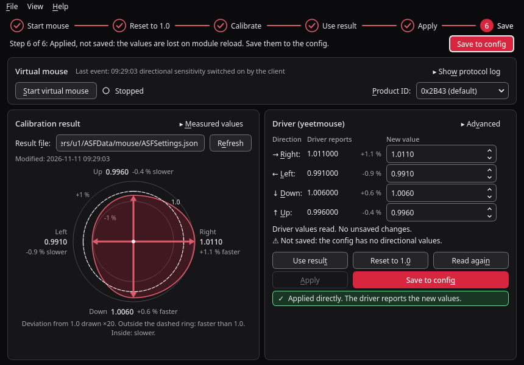

# QuadSens

QuadSens is a small Linux desktop tool for people who use the
[yeetmouse](https://github.com/AndyFilter/YeetMouse) mouse driver and want a
separate sensitivity multiplier for each direction (right, left, down, up).
The aim trainer Aimlabs can measure such multipliers, but it only offers that
calibration when it finds one specific mouse model. QuadSens presents a
virtual mouse that identifies as that model, so the calibration can be run
with any mouse, then reads the result and writes the four multipliers to a
patched yeetmouse kernel module.



The screenshot shows fixture data, after *Use result* and *Apply*, with
*Save to config* as the next step, in the default black and red theme. The
same window with colours taken from a light desktop is in
[docs/screenshot-system-light.png](docs/screenshot-system-light.png).

## How it works

1. **Virtual mouse.** QuadSens creates a virtual HID device through
   `/dev/uhid`. It identifies as a Corsair SABRE V3 PRO and answers that
   mouse's configuration protocol, which is what makes Aimlabs offer its
   per-direction sensitivity calibration (called PureVector or OmniSense
   there). The device never moves the pointer.
2. **Calibration result.** The calibration measures eight directions and
   reduces them to four multipliers (right, left, down, up). QuadSens reads
   them from the result file Aimlabs writes (`ASFSettings.json` in its Proton
   prefix) and from what Aimlabs sends to the virtual mouse, and shows the
   four multipliers as a diagram with their deviation from 1.0 in percent.
3. **Driver.** QuadSens writes the four multipliers to the `DirScaleXPos`,
   `DirScaleXNeg`, `DirScaleYPos` and `DirScaleYNeg` parameters of the patched
   yeetmouse module. It writes directly if your user is in group `yeetmouse`,
   otherwise through one `pkexec` call of a small helper script. *Save to
   config* then stores them in `/etc/yeetmouse.conf` with the fork's
   `yeetmousectl`, so that they survive a module reload.

## Requirements

- Linux with the `uhid` kernel module (part of every mainstream distribution
  kernel).
- The yeetmouse fork with directional scaling:
  <https://github.com/freasy/YeetMouse>, branch `feature/directional-scalars`.
  Its
  [DIRECTIONAL_SCALING.md](https://github.com/freasy/YeetMouse/blob/feature/directional-scalars/DIRECTIONAL_SCALING.md)
  explains the parameters and the installation. The unmodified yeetmouse does
  not have these parameters, and its `yeetmousectl` does not save them; install
  the fork's userspace tools along with the module.
- Aimlabs, installed through Steam and run with Proton.
- Read/write access to `/dev/uhid` for your user (see
  [One-time setup](#one-time-setup)).
- Only for running from source: Python 3.10 or newer with PySide6. PyQt6 is
  used as a fallback if PySide6 is missing. The binary needs neither.
- polkit (`pkexec`), for *Save to config* unless the config file is writable
  for you, and for the *Apply* fallback.

## Install

### Binary

Download the `quadsens` binary from the
[Releases page](https://github.com/freasy/quadsens/releases), make it
executable and run it:

```sh
chmod +x quadsens
./quadsens
```

The binary bundles Python and Qt but still needs a glibc at least as new as
the one it was built with (see the release notes). If it does not start on
your distribution, build it yourself, which takes one command.

The one-time setup below needs two files from this repository
(`99-quadsens.rules` and, optionally, `helper/quadsens-apply`), so clone it or
download those files as well.

### Build the binary from source

```sh
git clone https://github.com/freasy/quadsens.git
cd quadsens
./build.sh
```

`build.sh` creates a virtual environment in `.venv`, installs
PySide6-Essentials and PyInstaller into it from PyPI and writes a single-file
binary to `dist/quadsens`. It needs Python 3.10 or newer with the `venv`
module and does not install anything system-wide.

### Run from source

```sh
git clone https://github.com/freasy/quadsens.git
cd quadsens
python3 -m quadsens
```

This needs PySide6 from your distribution (Arch/Manjaro:
`sudo pacman -S pyside6`).

### Menu entry (optional)

```sh
install -Dm755 dist/quadsens ~/.local/bin/quadsens
install -Dm644 assets/quadsens.svg ~/.local/share/icons/hicolor/scalable/apps/quadsens.svg
install -Dm644 quadsens.desktop ~/.local/share/applications/quadsens.desktop
```

The menu entry starts the command `quadsens`, so `~/.local/bin` has to be in
your `PATH`.

## One-time setup

### Access to /dev/uhid

`99-quadsens.rules` gives group `input` access to `/dev/uhid` and to the
hidraw nodes of the virtual device. Without it neither QuadSens nor Proton can
open them.

```sh
sudo install -m 0644 99-quadsens.rules /etc/udev/rules.d/99-quadsens.rules
sudo udevadm control --reload
sudo udevadm trigger
sudo usermod -aG input "$USER"
```

Log out and in again, then check with `id -nG` that `input` is listed.

To undo: `sudo rm /etc/udev/rules.d/99-quadsens.rules`, followed by the same
two `udevadm` commands.

### Access to the driver parameters

The fork's `yeetmouse.service` hands the parameter files in
`/sys/module/yeetmouse/parameters/` to group `yeetmouse`. Join that group:

```sh
sudo usermod -aG yeetmouse "$USER"
```

Log out and in again. After that QuadSens reads and writes the parameters
without asking for a password.

### Helper for the pkexec fallback (optional)

If you are not in group `yeetmouse`, *Apply* can write the values through
`pkexec` instead. For that the helper script has to be installed system-wide:

```sh
sudo install -D -m 0755 helper/quadsens-apply /usr/local/libexec/quadsens-apply
```

The helper accepts exactly four plain decimal numbers between 0.1 and 10 and
writes only the four parameter files and `update`. The binary uses the helper
only from a system location (`/usr/local/libexec`, `/usr/libexec` or
`/usr/lib/quadsens`). When run from a checkout, QuadSens also falls back to
`helper/quadsens-apply` in the checkout. Without group membership the current
driver values cannot be read, so QuadSens cannot confirm what it wrote.

### Saving to the config file

*Save to config* runs the fork's `yeetmousectl save /etc/yeetmouse.conf`,
which writes the values the driver currently uses to the file that
`yeetmouse.service` applies at start. It needs the `yeetmousectl` of the fork
in `/usr/bin`, `/usr/local/bin` or `/bin`; the unmodified tool leaves the
directional values out. QuadSens reads the file back after saving and tells
you if they are missing.

`/etc/yeetmouse.conf` normally belongs to root, so the save asks for
authorization through `pkexec` (polkit). To save without a password prompt,
make the file writable for group `yeetmouse` once:

```sh
sudo chgrp yeetmouse /etc/yeetmouse.conf
sudo chmod 664 /etc/yeetmouse.conf
```

### Steam launch option

Proton has to pass the virtual device through to the game. Set this launch
option for Aimlabs in Steam (Properties > General > Launch options):

```
PROTON_ENABLE_HIDRAW=0x1B1C/0x2B43 %command%
```

`0x2B43` is the default product ID in QuadSens. If you choose another one in
the *Product ID* box, use the same value here.

## Usage

The row on top of the window shows six steps. A done step has a check mark,
the current one a filled circle and a bold title, pending ones are muted. The
filled button on the right always carries out the current step (Ctrl+Return);
the button that does the same inside a card is filled as well. The steps are worked out from what QuadSens finds,
not from what you clicked, and nothing is locked: the buttons in the panels
work in any order.

1. **Start mouse.** Press *Start virtual mouse*. The status next to the button
   changes to "Running: waiting for a client". Then start Aimlabs; the status
   changes to "Running: device opened by a client" once the game has found
   the virtual mouse.
2. **Reset to 1.0.** If the driver holds other values, press *Reset to 1.0 and
   apply*, so that the calibration measures the unscaled mouse. The step is
   done when all four driver values are exactly 1.
3. **Calibrate.** In Aimlabs open the Mouselabs section and run the
   per-direction sensitivity calibration with your real mouse. QuadSens
   notices the result on its own, either as a result file newer than the
   mouse start or as values sent to the virtual mouse. The diagram under
   *Calibration result* then shows what the driver will apply: a dashed ring
   for 1.0 and a curve through four arrows, one per direction. An arrow that
   ends outside the ring makes its direction faster, one that ends inside
   makes it slower; each is labelled with its value and percent. Deviations
   are drawn 20 times enlarged, as the caption says. *Measured values* shows
   the raw numbers, including the eight measured directions.
4. **Use result.** Press *Use result*. The four new values are filled in and
   the changed rows are marked as unsaved.
5. **Apply.** Press *Apply*. The *Driver reports* column shows what the module
   now uses.
6. **Save.** Press *Save to config*. Until then the panel says "Applied, not
   saved: lost on module reload"; afterwards "Saved to config". See
   [Saving to the config file](#saving-to-the-config-file).

To calibrate again later, start at step 1; resetting the driver to 1.0 makes
QuadSens wait for a new result.

Less common controls:

- *Show protocol log* shows every command the virtual mouse received. The line
  next to it names the last event that matters, for example that a
  calibration value arrived.
- *Advanced* in the driver panel holds *Flip Y* and *Apply saved values on
  start*. *Flip Y* exchanges the down and up values. The default mapping has
  been verified against real results, so leave it off unless up and down feel
  swapped on your setup. *Apply saved values on start* makes QuadSens write
  the last applied values again whenever it starts; it is not needed once the
  values are saved to the config.
- *View > Theme* chooses the look; see [Appearance](#appearance).
- *File > Open result folder* (Ctrl+O) opens the folder of the result file.
  *Help > First steps* (F1) shows the steps, and *Help > Setup help* lists
  what is not set up yet together with the commands to fix it.

The virtual mouse can also be run without the window:
`python3 -m quadsens.emulator` (options: `--pid`, `--state`, `--layout`).

QuadSens keeps its settings in `~/.config/QuadSens/QuadSens.conf` and the
state of the virtual mouse in
`~/.local/state/quadsens/virtual-mouse-state.json`.

## What this does and does not do

- The virtual device only identifies as that mouse and answers its
  configuration protocol. Every value it reports (battery level, firmware
  version, DPI stages and so on) is made up.
- No real hardware is modified. Nothing is written to any physical mouse.
- No game files are modified. QuadSens reads one result file and never writes
  to the game's directories.
- The only system file it changes is `/etc/yeetmouse.conf`, and only when you
  press *Save to config*; the writing is done by `yeetmousectl`.
- Presenting a virtual device to software that expects particular hardware may
  be against the terms of the software it interoperates with. Checking that is
  your responsibility.
- The multipliers are calibrated for your own aim on your own setup. They are
  not validated by any vendor, and there is no guarantee that they improve
  anything.

## Limitations and status

- Tested end to end on one machine: Manjaro, KDE Plasma, Aimlabs under Steam
  Proton. Other distributions, desktops and Proton versions are untested.
- The Y mapping is verified on that machine: the calibration's `YNeg` is the
  average of the upward directions and goes to the driver's "up" value. The
  *Flip Y* switch under *Advanced* exists only for setups where up and down
  still feel swapped.
- The driver takes four multipliers. The eight measured directions are
  displayed but not applied.
- New values are entered with four decimals.
- The virtual device is built from an analysis of the protocol. A future
  version of the game or of Proton may stop accepting it.
- Windows is not supported yet.

## Troubleshooting

**The calibration entry is not visible in Aimlabs.**
Start the virtual mouse before the game. Check that the Steam launch option is
set and that its product ID matches the one selected in QuadSens. Check that
the udev rule is installed and that you are in group `input`; without it
Proton cannot open the hidraw node. While the game is running, the status in
QuadSens should read "Running: device opened by a client" and the command log
should show traffic. If it stays at "waiting for a client", the game has not
found the device.

**"/dev/uhid is not writable" or "cannot create uhid device".**
The udev rule is missing or you are not in group `input` in the current
session. See [One-time setup](#one-time-setup) and log in again. If
`/dev/uhid` does not exist at all, load the module with `sudo modprobe uhid`.

**The driver panel says "not readable".**
Your session is not in group `yeetmouse`. Join the group and log out and in
again; `id -nG` must list it.

**It worked, then it says "not readable" again after reloading the module.**
The parameter files are created as `root:root` every time the module is
loaded. `yeetmouse.service` sets the group, so run it again:

```sh
sudo systemctl restart yeetmouse.service
```

**The driver panel says "module not loaded" or "no DirScale parameters".**
Load the module (`sudo modprobe yeetmouse`). If the parameters are still
missing, the loaded module is the unmodified yeetmouse and not the fork.

**Apply reports "helper script quadsens-apply not found".**
You are not in group `yeetmouse` and the helper is not installed system-wide.
Do one of the two (see [One-time setup](#one-time-setup)).

**The values are back to 1 after a reboot.**
They were applied but not saved. Apply them again and press *Save to config*.

**Save to config is greyed out.**
`yeetmousectl` was not found in `/usr/bin`, `/usr/local/bin` or `/bin`.
Install the userspace tools of the yeetmouse fork.

**Save to config reports "Nothing directional was saved".**
The installed `yeetmousectl` is the unmodified one, which does not know the
directional values. Install the fork's tools and save again.

## Appearance

*View > Theme* offers three looks. The choice applies at once and is
remembered.

- **QuadSens (black and red)**, the default: a near-black window with red as
  the accent. It stays the same whether the desktop is light or dark.
- **Follow system colours**: the same look with colours taken from the desktop
  palette, so it follows light and dark schemes and the desktop's accent
  colour, also while QuadSens is running.
- **System style**: no styling by QuadSens at all; the window uses the style
  and colours of the desktop.

The environment variable `QUADSENS_THEME=quadsens|system|native` overrides the
stored choice for one start. `QUADSENS_NATIVE_STYLE=1` is an older way to ask
for the system style.

In the first two themes text is kept at WCAG 2.1 AA contrast and the outlines
of controls and the focus ring at 3:1; colours that do not reach that are
strengthened. Because red is the accent in the default theme, red does not
mean "error" there: messages carry a mark and a word for their kind, and an
error has a neutral background with a heavy frame. There are no animations.

## Development

Run the tests from the repository root:

```sh
QT_QPA_PLATFORM=offscreen python3 -m unittest discover -s tests -t .
```

The tests never open `/dev/uhid`, run `pkexec` or write to `/sys` or `/etc`;
`tests/fake_yeetmousectl.py` stands in for the save tool. The UI
tests are skipped when no Qt binding is installed. To regenerate the
screenshots from fixture data:

```sh
python3 tools/make_screenshot.py
python3 tools/make_screenshot.py --theme system
python3 tools/make_screenshot.py --sheet /tmp/quadsens-sheet.png
```

The first two write `docs/screenshot.png` and
`docs/screenshot-system-light.png`. The last one renders a contact sheet of
the controls in their normal, hover, pressed, focused and disabled states in
every theme, for checking changes to the look by eye. `--diagrams DIRECTORY`
and `--gallery DIRECTORY` render the direction diagram and a problem state,
the About dialog and the Theme menu in the same way.

Layout:

```
quadsens/              application package
  emulator.py          virtual HID mouse and protocol (no Qt)
  calibration.py       find and parse the result file (no Qt)
  driver.py            read and write the module parameters (no Qt)
  persist.py           save to the config file and verify it (no Qt)
  steps.py             the six guided steps, derived from state (no Qt)
  model.py             value types and number parsing (no Qt)
  colors.py            colour mixing, contrast and the derived colour set (no Qt)
  hints.py, about.py   user-facing texts (no Qt)
  resources.py         locate bundled files (no Qt)
  ui/                  Qt widgets; ui/qt.py selects PySide6 or PyQt6,
                       ui/theme.py builds the stylesheet
helper/quadsens-apply  helper run through pkexec
assets/quadsens.svg    application icon
packaging/entry.py     entry point for the PyInstaller build
tools/make_screenshot.py
tests/
99-quadsens.rules      udev rule
quadsens.desktop       menu entry
build.sh               builds dist/quadsens
```

## License

GPL-3.0-or-later. See [LICENSE](LICENSE).

QuadSens is an independent project, not affiliated with or endorsed by Corsair or Aimlabs. All trademarks belong to their owners.
