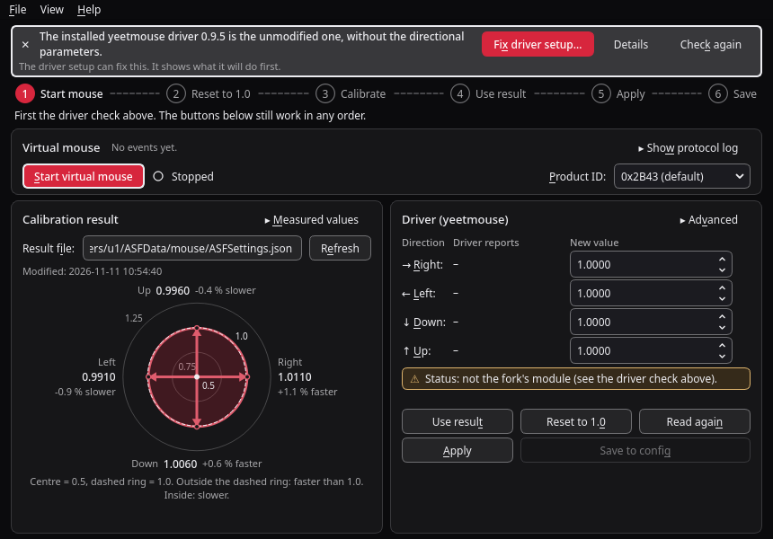
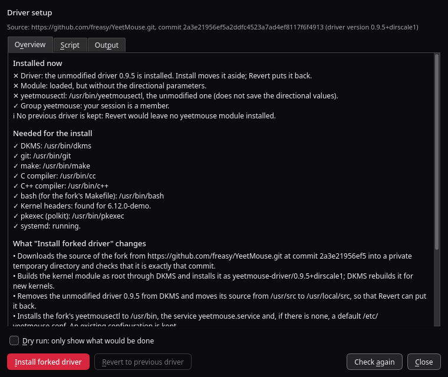
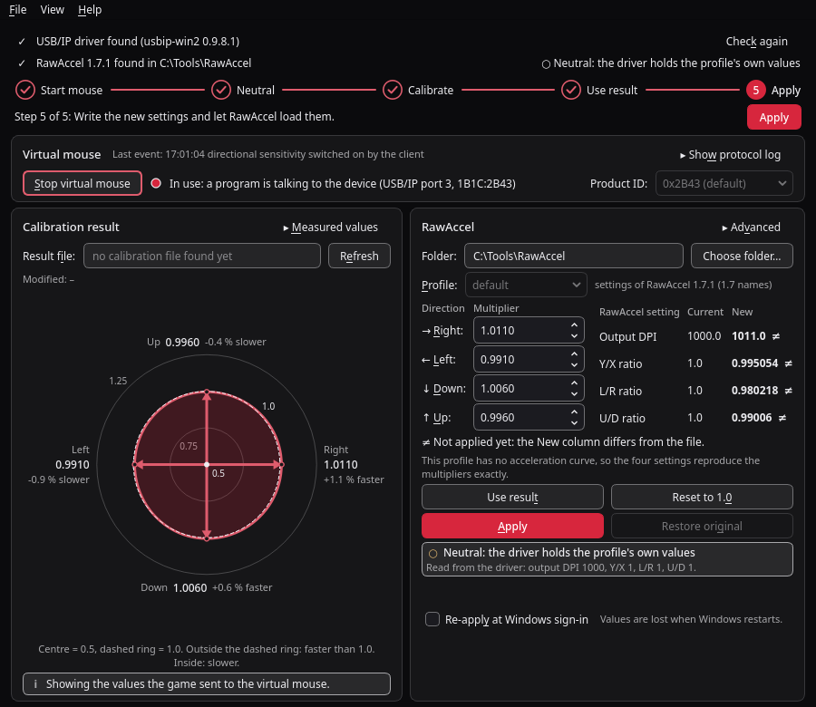

# QuadSens

QuadSens is a small Linux desktop tool for people who use the
[yeetmouse](https://github.com/AndyFilter/YeetMouse) mouse driver and want a
separate sensitivity multiplier for each direction (right, left, down, up).
The aim trainer Aimlabs can measure such multipliers, but it only offers that
calibration when it finds one specific mouse model. QuadSens presents a
virtual mouse that identifies as that model, so the calibration can be run
with any mouse, then reads the result and writes the four multipliers to a
patched yeetmouse kernel module.


The screenshot shows fixture data, after *Use result* and *Apply*, with
*Save to config* as the next step, in the default black and red theme. The
same window with colours taken from a light desktop is in
[docs/screenshot-system-light.png](docs/screenshot-system-light.png).

## How it works

1. **Virtual mouse.** QuadSens creates a virtual HID device through
   `/dev/uhid`. It identifies as a Corsair SABRE V3 PRO and answers that
   mouse's configuration protocol, which is what makes Aimlabs offer its
   per-direction sensitivity calibration (called PureVector or OmniSense
   there). The device never moves the pointer.
2. **Calibration result.** The calibration measures eight directions and
   reduces them to four multipliers (right, left, down, up). QuadSens reads
   them from the result file Aimlabs writes (`ASFSettings.json` in its Proton
   prefix) and from what Aimlabs sends to the virtual mouse, and shows the
   four multipliers as a diagram with their deviation from 1.0 in percent.
3. **Driver.** QuadSens writes the four multipliers to the `DirScaleXPos`,
   `DirScaleXNeg`, `DirScaleYPos` and `DirScaleYNeg` parameters of the patched
   yeetmouse module. It writes directly if your user is in group `yeetmouse`,
   otherwise through one `pkexec` call of a small helper script. *Save to
   config* then stores them in `/etc/yeetmouse.conf` with the fork's
   `yeetmousectl`, so that they survive a module reload.

## Requirements

- Linux with the `uhid` kernel module (part of every mainstream distribution
  kernel).
- The yeetmouse fork with directional scaling:
  <https://github.com/freasy/YeetMouse>, branch `feature/directional-scalars`.
  Its
  [DIRECTIONAL_SCALING.md](https://github.com/freasy/YeetMouse/blob/feature/directional-scalars/DIRECTIONAL_SCALING.md)
  explains the parameters and the installation. The unmodified yeetmouse does
  not have these parameters, and its `yeetmousectl` does not save them; install
  the fork's userspace tools along with the module. QuadSens can install the
  fork for you, see
  [Installing the driver from QuadSens](#installing-the-driver-from-quadsens).
- Aimlabs, installed through Steam and run with Proton.
- Read/write access to `/dev/uhid` for your user (see
  [One-time setup](#one-time-setup)).
- Only for running from source: Python 3.10 or newer with PySide6. PyQt6 is
  used as a fallback if PySide6 is missing. The binary needs neither.
- polkit (`pkexec`), for *Save to config* unless the config file is writable
  for you, and for the *Apply* fallback.

## Install

### Binary

Download the `quadsens` binary from the
[Releases page](https://github.com/freasy/quadsens/releases), make it
executable and run it:

```sh
chmod +x quadsens
./quadsens
```

The binary bundles Python and Qt but still needs a glibc at least as new as
the one it was built with (see the release notes). If it does not start on
your distribution, build it yourself, which takes one command.

The one-time setup below needs two files from this repository
(`99-quadsens.rules` and, optionally, `helper/quadsens-apply`), so clone it or
download those files as well.

### Build the binary from source

```sh
git clone https://github.com/freasy/quadsens.git
cd quadsens
./build.sh
```

`build.sh` creates a virtual environment in `.venv`, installs
PySide6-Essentials and PyInstaller into it from PyPI and writes a single-file
binary to `dist/quadsens`. It needs Python 3.10 or newer with the `venv`
module and does not install anything system-wide.

### Run from source

```sh
git clone https://github.com/freasy/quadsens.git
cd quadsens
python3 -m quadsens
```

This needs PySide6 from your distribution (Arch/Manjaro:
`sudo pacman -S pyside6`).

### Menu entry (optional)

```sh
install -Dm755 dist/quadsens ~/.local/bin/quadsens
install -Dm644 assets/quadsens.svg ~/.local/share/icons/hicolor/scalable/apps/quadsens.svg
install -Dm644 quadsens.desktop ~/.local/share/applications/quadsens.desktop
```

The menu entry starts the command `quadsens`, so `~/.local/bin` has to be in
your `PATH`.

## Installing the driver from QuadSens

The first line of the main window is the driver check. When everything is in
place it reads "Driver check passed". Otherwise it names the problem in plain
words and, where QuadSens can help, shows a *Fix driver setup…* button:



The button, the *Details* link next to it and *Help > Driver setup* all open
the same dialog. It shows which yeetmouse driver is installed, checks what an
install needs, and can install the fork or put the previous driver back.
Nothing runs by itself: each action has its own button, has to be confirmed,
and asks for your password once through `pkexec`.



**What it does.** The installer is one shell script,
[`helper/quadsens-driver.sh`](helper/quadsens-driver.sh). The dialog shows it
in full before you run it. Be aware of what that means: as root, it
**downloads source code from <https://github.com/freasy/YeetMouse> at one
pinned commit and builds a kernel module from it.** It checks that it got
exactly that commit and stops otherwise. The script text is passed to
`pkexec /bin/sh -s` on standard input, so what the dialog shows is what runs;
no file from your home directory or a temporary directory is executed as root.

**What it changes.**

- Builds and installs the module through DKMS as
  `yeetmouse-driver/0.9.5+dirscale1` (source in `/usr/src`).
- If an unmodified yeetmouse driver is installed through DKMS, removes it from
  DKMS and moves its source from `/usr/src` to `/usr/local/src`, so that it can
  be restored. A driver that belongs to a distribution package is not touched;
  the installer stops and asks you to remove the package first.
- Installs the fork's `yeetmousectl` to `/usr/bin`, `yeetmouse.service` and,
  if there is none, a default `/etc/yeetmouse.conf`. An existing configuration
  is kept. The fork's own settings window is not installed.
- Creates group `yeetmouse` if needed and adds you to it. Log out and in again
  afterwards.
- Reloads the module and restarts the service. Mouse acceleration is off for a
  moment while that happens.
- Records what it did in `/var/lib/quadsens/driver-state`.

**What it needs.** `dkms`, `git`, `make`, a C and a C++ compiler, `bash`, the
kernel headers for the running kernel, and `pkexec`. The dialog lists what is
missing together with the package to install on Arch/Manjaro, Debian/Ubuntu
and Fedora.

**Revert.** *Revert to previous driver* removes the fork's module and, if an
unmodified driver was moved aside, puts it back and loads it. If there was
none, no yeetmouse module is installed afterwards. `/etc/yeetmouse.conf` and
the group are kept either way.

**Dry run.** With *Dry run* ticked, the same script only looks at the system
and prints every command it would run. That needs no password and changes
nothing.

**If an install fails.** The module and the tool are built before the
installed driver is touched, so most failures change nothing. If it fails
later, the script puts the previous driver back and the dialog says which
state the system is in.

**Status of this feature.** State detection, the prerequisite check, the dry
run and the script's logic are tested against stand-in tools. A real revert
followed by a real install through this dialog has been run successfully on
one system (Manjaro, kernel 7.2, DKMS, previous driver installed with the
upstream `install.sh`). Other distributions, a driver installed from a
distribution package, and the failure rollback on a real system are untested;
keep the manual way at hand.

**By hand instead.** The fork documents the manual installation in its
[DIRECTIONAL_SCALING.md](https://github.com/freasy/YeetMouse/blob/feature/directional-scalars/DIRECTIONAL_SCALING.md).

## One-time setup

### Access to /dev/uhid

`99-quadsens.rules` gives group `input` access to `/dev/uhid` and to the
hidraw nodes of the virtual device. Without it neither QuadSens nor Proton can
open them.

```sh
sudo install -m 0644 99-quadsens.rules /etc/udev/rules.d/99-quadsens.rules
sudo udevadm control --reload
sudo udevadm trigger
sudo usermod -aG input "$USER"
```

Log out and in again, then check with `id -nG` that `input` is listed.

To undo: `sudo rm /etc/udev/rules.d/99-quadsens.rules`, followed by the same
two `udevadm` commands.

### Access to the driver parameters

The fork's `yeetmouse.service` hands the parameter files in
`/sys/module/yeetmouse/parameters/` to group `yeetmouse`. If you installed the
driver from QuadSens you are a member already. Otherwise join that group:

```sh
sudo usermod -aG yeetmouse "$USER"
```

Log out and in again. After that QuadSens reads and writes the parameters
without asking for a password.

### Helper for the pkexec fallback (optional)

If you are not in group `yeetmouse`, *Apply* can write the values through
`pkexec` instead. For that the helper script has to be installed system-wide:

```sh
sudo install -D -m 0755 helper/quadsens-apply /usr/local/libexec/quadsens-apply
```

The helper accepts exactly four plain decimal numbers between 0.1 and 10 and
writes only the four parameter files and `update`. The binary uses the helper
only from a system location (`/usr/local/libexec`, `/usr/libexec` or
`/usr/lib/quadsens`). When run from a checkout, QuadSens also falls back to
`helper/quadsens-apply` in the checkout. Without group membership the current
driver values cannot be read, so QuadSens cannot confirm what it wrote.

### Saving to the config file

*Save to config* runs the fork's `yeetmousectl save /etc/yeetmouse.conf`,
which writes the values the driver currently uses to the file that
`yeetmouse.service` applies at start. It needs the `yeetmousectl` of the fork
in `/usr/bin`, `/usr/local/bin` or `/bin`; the unmodified tool leaves the
directional values out. QuadSens reads the file back after saving and tells
you if they are missing.

`/etc/yeetmouse.conf` normally belongs to root, so the save asks for
authorization through `pkexec` (polkit). To save without a password prompt,
make the file writable for group `yeetmouse` once:

```sh
sudo chgrp yeetmouse /etc/yeetmouse.conf
sudo chmod 664 /etc/yeetmouse.conf
```

### Steam launch option

Proton has to pass the virtual device through to the game. Set this launch
option for Aimlabs in Steam (Properties > General > Launch options):

```
PROTON_ENABLE_HIDRAW=0x1B1C/0x2B43 %command%
```

`0x2B43` is the default product ID in QuadSens. If you choose another one in
the *Product ID* box, use the same value here.

## Usage

Below the driver check, a row shows six steps. A done step has a check mark,
the current one a filled circle and a bold title, pending ones are muted. The
filled button on the right always carries out the current step (Ctrl+Return);
the button that does the same inside a card is filled as well. The steps are worked out from what QuadSens finds,
not from what you clicked, and nothing is locked: the buttons in the panels
work in any order.

1. **Start mouse.** Press *Start virtual mouse*. The status next to the button
   changes to "Running: waiting for a client". Then start Aimlabs; the status
   changes to "Running: device opened by a client" once the game has found
   the virtual mouse.
2. **Reset to 1.0.** If the driver holds other values, press *Reset to 1.0 and
   apply*, so that the calibration measures the unscaled mouse. The step is
   done when all four driver values are exactly 1.
3. **Calibrate.** In Aimlabs open the Mouselabs section and run the
   per-direction sensitivity calibration with your real mouse. QuadSens
   notices the result on its own, either as a result file newer than the
   mouse start or as values sent to the virtual mouse. The diagram under
   *Calibration result* then shows what the driver will apply: a dashed ring
   for 1.0 and a curve through four arrows, one per direction. An arrow that
   ends outside the ring makes its direction faster, one that ends inside
   makes it slower; each is labelled with its value and percent. The scale
   is linear: the centre stands for 0.5 and the ring for 1.0, so a deviation
   of a percent or two is only a few pixels (*View > Diagram zoom* enlarges
   it). *Measured values* shows the raw numbers, including the eight measured
   directions.
4. **Use result.** Press *Use result*. The four new values are filled in and
   the changed rows are marked as unsaved.
5. **Apply.** Press *Apply*. The *Driver reports* column shows what the module
   now uses, and the line under the buttons says whether the driver is applying
   it (see below).
6. **Save.** Press *Save to config*. Until then the panel says "Applied, not
   saved: lost on module reload"; afterwards "Saved to config". See
   [Saving to the config file](#saving-to-the-config-file).

**Is it active?** The line under the buttons of the driver card says whether
the driver is applying the values, from a fresh read of the module
parameters after every *Apply* and every few seconds while the window is
visible: *Active in driver* with the four values and the time of the last
*Apply*, *Active, but different from QuadSens* when another program changed
them (both sets are shown), *Neutral* when all four are 1.0, *Not active*
with the reason (module not loaded, not the fork), or *Cannot be verified*
when the parameters are not readable for you. The driver check on top shows
the same in short. Reading needs no extra rights and writes nothing.

**Acceleration.** The head of the driver card shows the acceleration the
driver is set to, for example "Acceleration: Linear, 0.05; cap none", read
from the module parameters (or from `/etc/yeetmouse.conf` when the module
cannot be read, which it then says). *Acceleration* next to it opens the
editor; see [Editing the acceleration](#editing-the-acceleration). *Advanced >
Open yeetmouse settings…* starts the driver's own settings program
(`yeetmouse`, installed with the fork). A mode QuadSens does not know is
shown by its number, not guessed.

To calibrate again later, start at step 1; resetting the driver to 1.0 makes
QuadSens wait for a new result.

Less common controls:

- *Show protocol log* shows every command the virtual mouse received. The line
  next to it names the last event that matters, for example that a
  calibration value arrived.
- *Advanced* in the driver panel holds *Flip Y* and *Apply saved values on
  start*. *Flip Y* exchanges the down and up values. The default mapping has
  been verified against real results, so leave it off unless up and down feel
  swapped on your setup. *Apply saved values on start* makes QuadSens write
  the last applied values again whenever it starts; it is not needed once the
  values are saved to the config.
- *File > Export values…* writes the four multipliers (and the eight measured
  values, if known) to a small file, and *File > Import values…* reads one.
  The file holds nothing personal. It is how a calibration gets from Linux to
  the Windows preview.
- *View > Theme* chooses the look; see [Appearance](#appearance).
- *View > Diagram zoom* sets what the centre of the direction diagram stands
  for: 0.5 (default), 0.9 or 0.95, with the dashed ring always at 1.0. The
  closer the centre is to 1.0, the more a small deviation is spread out; the
  caption and the labels in the diagram state the scale in use.
- *File > Open result folder* (Ctrl+O) opens the folder of the result file.
  *Help > First steps* (F1) shows the steps, and *Help > Setup help* lists
  what is not set up yet together with the commands to fix it.

The virtual mouse can also be run without the window:
`python3 -m quadsens.emulator` (options: `--pid`, `--state`, `--layout`).

QuadSens keeps its settings in `~/.config/QuadSens/QuadSens.conf` and the
state of the virtual mouse in
`~/.local/state/quadsens/virtual-mouse-state.json`.

## What this does and does not do

- The virtual device only identifies as that mouse and answers its
  configuration protocol. Every value it reports (battery level, firmware
  version, DPI stages and so on) is made up.
- No real hardware is modified. Nothing is written to any physical mouse.
- No game files are modified. QuadSens reads one result file and never writes
  to the game's directories.
- In normal use the only system file it changes is `/etc/yeetmouse.conf`, and
  only when you press *Save to config*; the writing is done by `yeetmousectl`.
- *Help > Driver setup* is the exception: on request it installs or removes a
  kernel module and the files listed under
  [Installing the driver from QuadSens](#installing-the-driver-from-quadsens).
- Presenting a virtual device to software that expects particular hardware may
  be against the terms of the software it interoperates with. Checking that is
  your responsibility.
- The multipliers are calibrated for your own aim on your own setup. They are
  not validated by any vendor, and there is no guarantee that they improve
  anything.

## Windows (preview)

**Status:** verified on one real Windows 11 PC and one Windows 11 VM:
installing both tools from QuadSens, the automatic attach of the virtual
mouse, the calibration in the game over the virtual mouse, and *Apply* to
RawAccel all worked. That is one PC and one set of versions; other setups are
untested. **Newer than that test and not yet run on Windows:** the "active"
indicator with its read-back from RawAccel's driver, and *Re-apply at Windows
sign-in*.

On Windows QuadSens has two parts: a virtual mouse served over USB/IP, which
receives the calibration from the game, and a panel that writes the four
multipliers into RawAccel's settings. The second part works without the
first.



(The picture was rendered on Linux and shows the layout, not Windows itself.)

**What works**

- The virtual mouse, if [usbip-win2](https://github.com/vadimgrn/usbip-win2)
  is installed (see below).
- Getting the four multipliers in four ways: from what the game writes to
  the virtual mouse; from the newest result file of the game, if there is
  one (looked for in
  `%USERPROFILE%\AppData\LocalLow\Statespace\aimlab_tb\Users\<id>\ASFData\<device>\ASFSettings.json`;
  that location is an assumption taken from the layout on Linux); *File >
  Import values…* with a file exported by QuadSens on Linux; or typing them.
- The diagram, as on Linux.
- Writing the multipliers into the settings of
  [RawAccel](https://github.com/RawAccelOfficial/rawaccel) and letting it load
  them.

**What does not**

- Nothing is re-applied at start by QuadSens (see below).
- QuadSens does not remove usbip-win2 or RawAccel; see
  [Installing the two tools](#installing-the-two-tools) for how to do that.

### Installing the two tools

The first two lines of the window say whether
usbip-win2 and RawAccel were found, and in which version. Each has an
*Install…* button. You can equally install both yourself from their release
pages and press *Check again* (for RawAccel: *Choose folder…*).

What the buttons do, always after a dialog that says so and waits for you:

- **Only the tested versions.** QuadSens installs exactly usbip-win2 0.9.8.1
  (`USBip-0.9.8.1-x64.exe`) and RawAccel 1.7.1 (`RawAccel_v1.7.1.zip`). The
  file is downloaded from the project's releases on github.com over HTTPS and
  must match the size and SHA-256 checksum built into QuadSens; otherwise it
  is deleted and nothing is started. The dialog shows the checksum.
- **usbip-win2:** the installer is additionally checked for its signature
  (signer "Cloudyne Systems (Scheibling Consulting AB)", through which the
  project signs), then started. Windows asks for administrator rights. While
  it installs, all USB devices can disconnect for a moment, and at its end
  the installer asks to restart the computer. An older usbip-win2 is replaced
  by the installer itself. Its own README advises making a restore point
  first.
- **RawAccel:** the zip is unpacked into a folder you confirm (default
  `%LOCALAPPDATA%\Programs\RawAccel`; it must be yours to write to, because
  RawAccel keeps `settings.json` there), each program file is checked against
  its checksum, and RawAccel's `installer.exe` is started, which installs the
  mouse driver. Windows asks for administrator rights. That installer is not
  signed by its makers, so the checksum is the only check. **RawAccel works
  only after the computer was restarted**; QuadSens never restarts it, shows
  "restart Windows" in the strip until then, and *Apply* needs that restart
  first. After the restart start `rawaccel.exe` once, so that it writes its
  `settings.json`. RawAccel names the Visual C++ 2019 runtime and the .NET
  Framework 4.7.2 or newer as prerequisites.
- **Newer versions.** When it starts, and on *Check again*, QuadSens asks
  `api.github.com` for the newest release of both projects and shows a quiet
  line with a link if one is newer than the tested version. It does not
  download or install versions it was not tested with. Nothing else is sent,
  and there is no other telemetry. *Help > Check for newer tool versions
  online* switches it off, as does the environment variable
  `QUADSENS_NO_ONLINE_CHECK=1`. Without a network nothing happens and nothing
  is reported.
- An installed version that differs from the tested one is shown as
  information; *Install tested version…* is offered only for an older one.

Downloads are kept in `%LOCALAPPDATA%\QuadSens\downloads` and are checked
again each time before use.

**Removing them.** usbip-win2: *Windows Settings > Apps > Installed apps*,
find USBip, *Uninstall*. RawAccel: run `uninstaller.exe` in the RawAccel
folder, restart the computer, then delete the folder. The same is under *Help
> Setup help*.

**Licenses.** QuadSens downloads these tools from their projects and does not
contain or redistribute them. usbip-win2 is under the BSD 2-Clause license,
RawAccel under the MIT license.

### The virtual mouse on Windows

Windows has no `/dev/uhid`. QuadSens serves the virtual mouse as a USB/IP
device instead, and usbip-win2 attaches it as if it were plugged in.

- **It needs usbip-win2.** The first line of the window says whether it was
  found and can install the tested version; see
  [Installing the two tools](#installing-the-two-tools). Its installer needs
  administrator rights and restarts the USB hubs, so all USB devices drop out
  for a moment.
- **Start virtual mouse** does two things in one click: it serves the device
  on this PC and runs `usbip.exe attach -r 127.0.0.1 -b 1-1` for you, without
  a console window. **Stop** detaches the port QuadSens attached (that port
  only, never all) and stops serving. Closing QuadSens does the same.
- **This PC only.** The server listens on `127.0.0.1`, port 3240. There is no
  setting to listen on the network.
- **What the device is.** It identifies itself as another vendor's mouse
  (USB ID `1B1C:2B43` by default) because the game only offers the
  calibration for such a device, and it answers the vendor software's
  questions with made-up values. It never moves the pointer.
- Attaching never asks for administrator rights. If Windows refuses the
  attach on your machine, the card shows the command to run in a console
  opened as administrator.

The card shows the state in words: *Stopped*, *Serving on 127.0.0.1:3240,
waiting for attach*, *Attached: Windows sees the device*, *In use: a program
is talking to the device*, or *Stopped after an error*.

**Fallback: attach by hand.** If `usbip.exe` is not found or the automatic
attach fails, QuadSens keeps serving. Open the USBip app that comes with
usbip-win2, enter `127.0.0.1` and attach the device there. QuadSens notices
it. On *Stop* it then detaches nothing (it did not attach it); it stops
serving and the device disappears on the Windows side.

**Trouble with the virtual mouse**

- *Stays at "waiting for attach".* Read the message in the card; it quotes
  what `usbip.exe` said. Try the fallback above.
- *"Windows refused the attach" / access denied.* Run the command from the
  message in a console opened as administrator, or use the USBip app.
- *"Port 3240 on 127.0.0.1 is not available".* Another program holds the
  port (a second QuadSens, or a USB/IP server such as usbipd), or Windows
  has reserved it. Close that program and start again; if nothing is using
  the port, restart the PC.
- *The device is still there after a crash.* In a console: `usbip port`
  lists the attached devices; find the one with
  `usbip://127.0.0.1:3240/1-1` and remove it with `usbip detach -p <port>`.
- *The game does not offer the calibration.* Start the virtual mouse before
  the game.

**Requirements**

- RawAccel, installed from QuadSens or as its own instructions say. QuadSens was
  written against the setting names of RawAccel 1.7.1 and also recognises
  those of 1.6.x; with any other naming it refuses to write.
- The folder must be writable for you, because `settings.json` in it is
  changed.

**Usage with the virtual mouse** (the step row on top leads through it)

1. *Start virtual mouse*, then start the game.
2. *Restore original values* if RawAccel still holds multipliers from an
   earlier run, so that the calibration measures the unscaled mouse. The
   step is ticked by itself when the settings are untouched. This needs the
   RawAccel folder: *Choose folder…* and pick the folder that holds
   `rawaccel.exe`, `writer.exe` and `settings.json`. A few common places are
   tried on their own. With several profiles, pick the one to change.
3. Run the per-direction calibration in the game. The values it writes to
   the virtual mouse appear in the window.
4. *Use result*.
5. Look at the table (current and new value of the four RawAccel settings:
   output DPI or sensitivity, Y/X ratio, L/R ratio, U/D ratio) and press
   *Apply*. It writes `settings.json` and runs `writer.exe settings.json`,
   which makes RawAccel load it. If `writer.exe` reports a problem it shows
   its own message window.

**Usage without usbip-win2 (apply only).** Calibrate on Linux and use *File >
Export values…* there, then *File > Import values…* on Windows, or type the
four multipliers. The step row then starts at the values and leaves the
first three steps aside. Choose the RawAccel folder, check the table, *Apply*.

**Exact or approximate.** RawAccel applies these four settings after its
acceleration curve; the Linux driver applies the multipliers before the curve.
For a profile without acceleration the result is exactly the four
multipliers. With an acceleration curve it is an approximation. The panel
says which case the selected profile is.

**Backup and restore.** The first time QuadSens changes a settings file it
keeps a copy next to it, `settings.quadsens-backup-YYYYmmdd-HHMMSS.json`, and
remembers the four original values of the profile. New values are always
computed from those originals, so applying again does not multiply twice.
*Restore original* writes the four originals back. Only those four numbers
are ever changed; the rest of the file stays byte for byte. If you change the
four settings in RawAccel yourself later, QuadSens takes your values as the
new originals.

**Is it active?** Under *Apply* a line says whether RawAccel's driver is
applying the values, and the same is shown in short in the RawAccel line on
top. Where the driver can be read (RawAccel 1.7), QuadSens reads the four
settings back from it every few seconds, without changing anything: *Active
in driver* (equal to what was applied, with the time), *Active, but different
from QuadSens* (something else changed them; both are shown), *Neutral* (the
profile's own values), *Not applied since Windows started* (the driver runs
but holds no settings), or *Not active* with the reason (driver not
installed, restart pending, not running). With another driver version the
values cannot be read back; the line then says *Sent to the driver HH:MM:SS,
accepted by RawAccel's writer*, which is what is known, and *Not applied
since Windows started* once Windows was restarted after that.

**Acceleration.** Under the profile the card shows the acceleration of the
selected profile as RawAccel's settings file names it. *Acceleration* opens
the editor; see [Editing the acceleration](#editing-the-acceleration). *Open
RawAccel* starts `rawaccel.exe` from the chosen folder. *Restore original*
also puts the profile's original acceleration settings back, exactly as they
were in the file.

**After a restart.** RawAccel's driver forgets its settings when Windows
shuts down; they stay in `settings.json`. Tick *Re-apply at Windows sign-in*
in the RawAccel card to have them loaded again each time you sign in. It is
off by default; without it the card says "Values are lost when Windows
restarts". What ticking does: it writes one value into the registry of your
user account, `HKEY_CURRENT_USER\Software\Microsoft\Windows\CurrentVersion\Run`,
name `QuadSens RawAccel settings`, data `"<folder>\writer.exe"
"<folder>\settings.json"`. Windows then runs RawAccel's `writer.exe` at
sign-in; no console appears, and `writer.exe` shows its own message if
something is wrong. No administrator rights are needed. Unticking removes the
value; if you choose another RawAccel folder, the entry moves with it. To
remove it by hand: *Task Manager > Startup apps*, or delete the value with
`regedit`. The checkbox always shows what is really in the registry.

**Up and down.** The mapping of the calibration's two vertical values was
verified on Linux only. If up and down feel swapped after applying, tick
*Flip up/down* under *Advanced* and apply again.

**Getting the program.** There is no released Windows build yet. Build it
with `powershell -ExecutionPolicy Bypass -File build-windows.ps1` (needs
Python 3.10 or newer), which writes `dist\quadsens.exe`. The executable is not
signed, so Windows SmartScreen will warn about an unknown publisher the first
time; that is expected for an unsigned program.

## Editing the acceleration

**New, and not yet tried on a real mouse on either system.** The numbers
below come from the drivers' sources and from a userspace build of the
yeetmouse fork's code, not from a running driver.

Both driver cards have an *Acceleration* disclosure, closed by default. It
edits six modes that yeetmouse and RawAccel compute the same way once the
parameters are renamed:

| Mode | Parameters |
|---|---|
| Off | none |
| Linear | acceleration 0.0001 to 1; optional cap 0.1 to 10 |
| Classic | acceleration 0.0001 to 2; exponent 1.01 to 5; optional cap 0.1 to 10 |
| Power | scale 0.001 to 5; exponent 0.01 to 1; output offset 0 to 5; optional cap up to 10, above the offset |
| Natural | decay rate 0.001 to 5; limit 0.01 to 8, not within 0.01 of 1; input offset 0 to 50; gain on or off |
| Jump | jump at speed 0.1 to 50; multiplier after the jump 0.01 to 10; smoothness 0 to 1; gain on or off |

Speeds are in counts per millisecond. The preview draws the multiplier over
the speed, the curve being edited as a solid line and the one in the driver
as a dashed line, with the cap, offset or jump point marked. Nothing changes
until you press *Apply acceleration*; before that the editor shows "Current:
… → New: …". *Revert to previous* goes back one step, to what was active
before the last *Apply acceleration*.

**Acceleration changes how the mouse feels far more than the four directional
values.** A calibration reflects the acceleration that is active while you
calibrate, so set the curve first and calibrate afterwards. And the two
systems apply the directional values at different places: Linux before the
curve, Windows after it. With acceleration on, the same four values therefore
do not give exactly the same result on both.

**What is refused, and why.** The limits above are narrower than either
driver's own, and some combinations inside them are refused as well, with the
reason shown under the preview:

- a cap or offset whose point on the curve would lie beyond 100000 counts/ms
  (for example Power with scale 0.5, exponent 0.05 and cap 3);
- Power with an output offset above 99 × scale × exponent, or a cap that is
  not above the offset;
- a curve whose multiplier at 1000 counts/ms would exceed 100000.

The reason is the yeetmouse fork: its fixed-point code divides without
checking ranges. A userspace build of its unmodified sources stopped with a
divide error for such sets, including sets its own settings program allows;
what the kernel does then was not tested. Other sets make it switch
acceleration off without telling. QuadSens therefore checks before it writes,
on both systems, so that the same curves are available on both. The same
checks are built into the pkexec helper, which does not trust its caller.

**Everything else stays in the driver's own program.** If the driver is set
to something outside these six modes, the editor is read-only and says why:
on Linux another mode (Motivity, Synchronous, look-up table, custom curve),
or `Offset`, `InputCap`, `OutputCap` or `PreScale` in use; on Windows
separate curves per axis, `lpNorm` other than 2, weights, a speed cap,
smoothing halflives, a cap mode other than "output", a cap without gain, a
device DPI, or the modes `lut`, `synchronous` and `motivity`. QuadSens never
converts such a configuration. Rotation, snapping and sensitivity are not
touched at all.

**Linux details.** The curve is written to the module parameters with ten
decimals, all four shared parameters and the mode every time, then
`UseSmoothing`, then `update`; directly if you may write them, otherwise
through the pkexec helper (install the current `helper/quadsens-apply` if
yours is older; it then answers "expected exactly four values"). It takes
effect with the next mouse movement, within a second. Afterwards QuadSens
reads the parameters back. **The module does not report whether it accepted
a set**: when it rejects one it keeps the written text and only writes to the
kernel log. QuadSens says so, and relies on its checks. If the read-back
differs from what was written, that is shown as an error with *Revert to
previous*. *Save to config* persists the curve like the directional values;
the fork's `yeetmousectl` keeps six significant digits when it saves, so
after a reload a parameter can differ from the ten decimals QuadSens wrote in
the seventh digit.

**Windows details.** Only the needed values inside the profile's "Whole or
horizontal accel parameters" are changed; the rest of `settings.json` stays
byte for byte. The cap, the cap mode and the gain switch are always written,
because RawAccel shares those between modes. The result must pass a port of
RawAccel's own check before `writer.exe` is run. The first change keeps a
backup of the file and remembers the original acceleration settings;
*Restore original* puts them back exactly. With RawAccel 1.7 the indicator
also reads the mode and parameters back from the driver.

**Accuracy.** As formulas the six modes are the same in both drivers. The
fork computes them in fixed point; measured against RawAccel's
double-precision formulas for speeds from 0.01 to 150 counts/ms, its
multiplier differs by at most about 2e-5 (relative) for Linear, Classic,
Power and Jump, and for Natural with gain by up to 1e-2 at very low speeds
(0.01 counts/ms), shrinking as the speed rises. Details, sources and what is
still uncertain: [docs/accel-modes.md](docs/accel-modes.md).

## Limitations and status

- Tested end to end on one machine: Manjaro, KDE Plasma, Aimlabs under Steam
  Proton. Other distributions, desktops and Proton versions are untested.
- The Y mapping is verified on that machine: the calibration's `YNeg` is the
  average of the upward directions and goes to the driver's "up" value. The
  *Flip Y* switch under *Advanced* exists only for setups where up and down
  still feel swapped.
- The driver takes four multipliers. The eight measured directions are
  displayed but not applied.
- New values are entered with four decimals.
- The virtual device is built from an analysis of the protocol. A future
  version of the game or of Proton may stop accepting it.
- Windows: a preview, verified on one Windows 11 PC and one VM; see
  [Windows (preview)](#windows-preview).

## Troubleshooting

**The calibration entry is not visible in Aimlabs.**
Start the virtual mouse before the game. Check that the Steam launch option is
set and that its product ID matches the one selected in QuadSens. Check that
the udev rule is installed and that you are in group `input`; without it
Proton cannot open the hidraw node. While the game is running, the status in
QuadSens should read "Running: device opened by a client" and the command log
should show traffic. If it stays at "waiting for a client", the game has not
found the device.

**"/dev/uhid is not writable" or "cannot create uhid device".**
The udev rule is missing or you are not in group `input` in the current
session. See [One-time setup](#one-time-setup) and log in again. If
`/dev/uhid` does not exist at all, load the module with `sudo modprobe uhid`.

**The driver check says "Log out and in again" or "not readable".**
Your session is not in group `yeetmouse` yet. Log out and in again; `id -nG`
must list the group. If you are not a member at all, the driver check offers
*Fix driver setup…*, which adds you.

**It worked, then it says "not readable" again after reloading the module.**
The parameter files are created as `root:root` every time the module is
loaded. `yeetmouse.service` sets the group, so run it again:

```sh
sudo systemctl restart yeetmouse.service
```

**The driver check does not pass.**
The line on top of the window says why and what to do: install the fork
(*Fix driver setup…*), load the module (`sudo modprobe yeetmouse`), log out and
in again after you were added to group `yeetmouse`, or install what the
installer needs. *Check again* looks once more.

**Driver setup stops with "belongs to the package ...".**
Your yeetmouse driver was installed by the package manager. Remove that
package, then run the install again.

**Driver setup failed.**
The result line names the state the system is in, and the *Output* page has
the numbered steps. *Revert to previous driver* puts the old driver back; the
manual commands are in the fork's DIRECTIONAL_SCALING.md.

**Apply reports "helper script quadsens-apply not found".**
You are not in group `yeetmouse` and the helper is not installed system-wide.
Do one of the two (see [One-time setup](#one-time-setup)).

**The values are back to 1 after a reboot.**
They were applied but not saved. Apply them again and press *Save to config*.

**Save to config is greyed out.**
`yeetmousectl` was not found in `/usr/bin`, `/usr/local/bin` or `/bin`.
Install the userspace tools of the yeetmouse fork; *Help > Driver setup* does
that as part of the install.

**Save to config reports "Nothing directional was saved".**
The installed `yeetmousectl` is the unmodified one, which does not know the
directional values. Install the fork's tools and save again.

## Appearance

*View > Theme* offers three looks. The choice applies at once and is
remembered.

- **QuadSens (black and red)**, the default: a near-black window with red as
  the accent. It stays the same whether the desktop is light or dark.
- **Follow system colours**: the same look with colours taken from the desktop
  palette, so it follows light and dark schemes and the desktop's accent
  colour, also while QuadSens is running.
- **System style**: no styling by QuadSens at all; the window uses the style
  and colours of the desktop.

The environment variable `QUADSENS_THEME=quadsens|system|native` overrides the
stored choice for one start. `QUADSENS_NATIVE_STYLE=1` is an older way to ask
for the system style.

In the first two themes text is kept at WCAG 2.1 AA contrast and the outlines
of controls and the focus ring at 3:1; colours that do not reach that are
strengthened. Because red is the accent in the default theme, red does not
mean "error" there: messages carry a mark and a word for their kind, and an
error has a neutral background with a heavy frame. There are no animations.

## Development

Run the tests from the repository root:

```sh
QT_QPA_PLATFORM=offscreen python3 -m unittest discover -s tests -t .
```

The tests never open `/dev/uhid`, run `pkexec` or write to `/sys` or `/etc`;
`tests/fake_yeetmousectl.py` stands in for the save tool. The UI
tests are skipped when no Qt binding is installed. To regenerate the
screenshots from fixture data:

```sh
python3 tools/make_screenshot.py
tools/usbip_spike/     command line front end of the USB/IP server, for testing
python3 tools/make_screenshot.py --theme system
python3 tools/make_screenshot.py --sheet /tmp/quadsens-sheet.png
```

The first two write `docs/screenshot.png` and
`docs/screenshot-system-light.png`. The last one renders a contact sheet of
the controls in their normal, hover, pressed, focused and disabled states in
every theme, for checking changes to the look by eye. `--diagrams DIRECTORY`
and `--gallery DIRECTORY` render the direction diagram and a problem state,
the About dialog and the Theme menu in the same way.

Layout:

```
quadsens/              application package
  emulator.py          virtual HID mouse and protocol (no Qt)
  calibration.py       find and parse the result file (no Qt)
  driver.py            read and write the module parameters (no Qt)
  driver_setup.py      detect the installed driver, prerequisites (no Qt)
  platforms.py         which platform, where the result file is (no Qt)
  values_file.py       the values file for import and export (no Qt)
  rawaccel.py          RawAccel settings on Windows (no Qt)
  usbip_server.py      the virtual mouse as a USB/IP device, for Windows (no Qt)
  usbip_client.py      runs usbip.exe of usbip-win2: attach, find our port, detach (no Qt)
  usbip_mouse.py       server plus attach as one thing with states (no Qt)
  win_tools.py         the pinned releases of usbip-win2 and RawAccel (no Qt)
  win_download.py      fetch a pinned file and check it (no Qt)
  win_install.py       unpack, check and start the installers (no Qt)
  win_autostart.py     the opt-in startup entry for RawAccel's writer (no Qt)
  rawaccel_live.py     read RawAccel's driver state, read-only (no Qt)
  active.py, active_linux.py   "is the driver applying it", in words (no Qt)
  accel.py             acceleration settings of both drivers, read-only (no Qt)
  accel_edit.py        the six editable curves: limits, reference curve, values for
                       both drivers (no Qt)
  persist.py           save to the config file and verify it (no Qt)
  steps.py             the guided steps, derived from state (no Qt)
  model.py             value types and number parsing (no Qt)
  colors.py            colour mixing, contrast and the derived colour set (no Qt)
  hints.py, uhid_text.py, about.py   user-facing texts (no Qt)
  resources.py         locate bundled files (no Qt)
  ui/                  Qt widgets; ui/qt.py selects PySide6 or PyQt6,
                       ui/theme.py builds the stylesheet
helper/quadsens-apply  helper run through pkexec
helper/quadsens-driver.sh  installs or reverts the fork (fed to pkexec sh)
assets/quadsens.svg    application icon
packaging/entry.py     entry point for the PyInstaller build
tools/make_screenshot.py
tests/
99-quadsens.rules      udev rule
quadsens.desktop       menu entry
build.sh               builds dist/quadsens
build-windows.ps1      builds dist\quadsens.exe
.github/workflows/     tests and builds in CI
```

## License

GPL-3.0-or-later. See [LICENSE](LICENSE).

QuadSens is an independent project, not affiliated with or endorsed by Corsair or Aimlabs. All trademarks belong to their owners.
